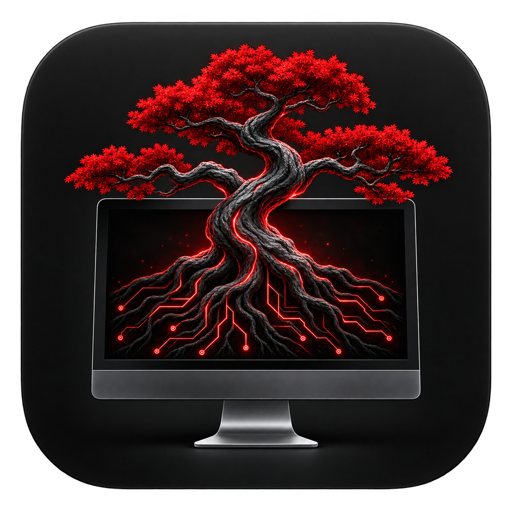

<h1 align="center">AppleSeed</h1>

Free, open-source remote desktop access over Tailscale.

AppleSeed has one edition. Every feature is included: remote desktop, monitor switching, keyboard and trackpad control, pinch zoom, Auto/Quality/Speed streaming, custom session timers, secure Mac unlock, display controls where supported, and an optional browser Web Portal.

[Downloads and setup](https://erhan.ai/appleseed) · [Releases](https://github.com/eaTurk1/AppleSeed/releases) · [Build from source](docs/BUILDING.md) · [Optional support](https://erhan.ai/appleseed/#support)

## Platforms

| Platform | Role | Requirements and current status |
| --- | --- | --- |
| Android | Remote client | Signed APK, Android 9+. Update over an earlier official AppleSeed APK to retain settings and encrypted credentials. |
| macOS | Host companion | Apple silicon, macOS 13+, Screen Sharing and Tailscale. Native secure-field unlock and display/sleep controls. |
| Windows | Client and host bridge | Portable x64 desktop app. Hosting requires a separately installed password-protected VNC server bound to localhost. |
| Linux | Client and host bridge | Portable x64 and ARM64 apps. Hosting requires a local VNC server, such as an X11 desktop server. Wayland support depends on the VNC server and compositor. |
| iOS / iPadOS | Native remote client | iOS 16+. Xcode project and unsigned device/simulator builds. Public installation through TestFlight/App Store requires Apple Developer signing; an unsigned build is not an installable App Store release. |
| Browser | Remote client | Private Tailscale URL, or the temporary Web Portal enabled from an authenticated AppleSeed client. |

The new Windows, Linux and iOS ports are development builds. Build verification does not establish every desktop environment, VNC server, phone, or cold-boot combination.

## Start with a Mac

1. Connect Tailscale on the Mac and client under the same user identity.
2. Enable **System Settings → General → Sharing → Screen Sharing** and allow your Mac account.
3. Install **AppleSeed.app**, open its menu, and choose **Setup Mac service…**.
4. Choose **Copy Mac address** and paste that private HTTPS `.ts.net:9447` address into the client.
5. Connect using the authorized Mac account. Choose **Remember on this phone** if desired.

**Unlock** is on the opening screen and live toolbar. It opens a compact strip below the Mac image so the login screen stays visible. Choose your account if macOS shows multiple accounts, then tap **Unlock Mac**. Each submission checks the Mac's current lock state and fills only a secure field owned by Apple's login process. Delayed video cannot authorize password entry into an unlocked desktop app. Enable AppleSeed in macOS Accessibility first. Windows/Linux hosts use their normal remote keyboard for OS sign-in; the Mac shortcut is not offered there.

**Full screen** is beside Disconnect while viewing your desktop. It hides the app toolbars and phone system bars. Use the small **Controls** button for the toolbar, or **Exit full screen** to return. Your monitor selection and zoom stay intact.

## Windows and Linux hosts

Open the desktop app, expand **Share this computer**, and follow [the host setup](docs/DESKTOP.md). AppleSeed bridges an existing local VNC server through private Tailscale Serve. It does not install a VNC service, change account security, or open a public VNC port. Keep the desktop app running in its tray while sharing.

## Web Portal

Open **Web Portal** directly from the opening screen or live toolbar. Choose a duration and enable it to receive a random, one-use eight-character code. A browser can connect without installing Tailscale, using your configured public `/remote` URL. Two browser windows can show separate monitors of the same desktop.

The public route is off until enabled, expires automatically, and is revoked immediately by Disable. Configure its HTTPS reverse proxy separately. The owner API and VNC port stay private. See [Web Portal setup and security](docs/WEB-PORTAL.md).

## Privacy and limits

- No developer account, purchase, license key or payment is required.
- Optional tips support development and unlock no features.
- Credentials are kept on your devices. Android uses Android Keystore; iOS uses device-bound Keychain; desktop remembering requires an available OS encryption backend. Linux refuses plaintext fallback storage.
- A locked, online Mac is reachable while its services and Tailscale are running. AppleSeed cannot power on an offline computer or unlock FileVault's preboot screen.
- The Mac companion and new desktop builds are not commercially notarized/code-signed. Review source and checksums before installation.
- iOS may suspend remote connections in the background. Android's foreground service retains its session when the activity closes; force-stop, process termination or network loss can still end it.
- People near a host monitor can see the session. Monitor privacy covers and virtual mobile workspaces are not included.

Useful for configuring an OpenClaw, Codex, or other workstation and personally approving a permission prompt. AppleSeed does not bypass OS permissions or passwords and is not affiliated with Apple, Tailscale, OpenClaw or OpenAI.

## Open source

The complete application source is distributed under [MIT](LICENSE); dependencies retain their own [licenses](THIRD_PARTY_NOTICES.md). See [CONTRIBUTING](CONTRIBUTING.md), [SECURITY](SECURITY.md), and [privacy information](PRIVACY.md). Never put passwords, private device addresses, tokens or signing keys in issues or pull requests.
